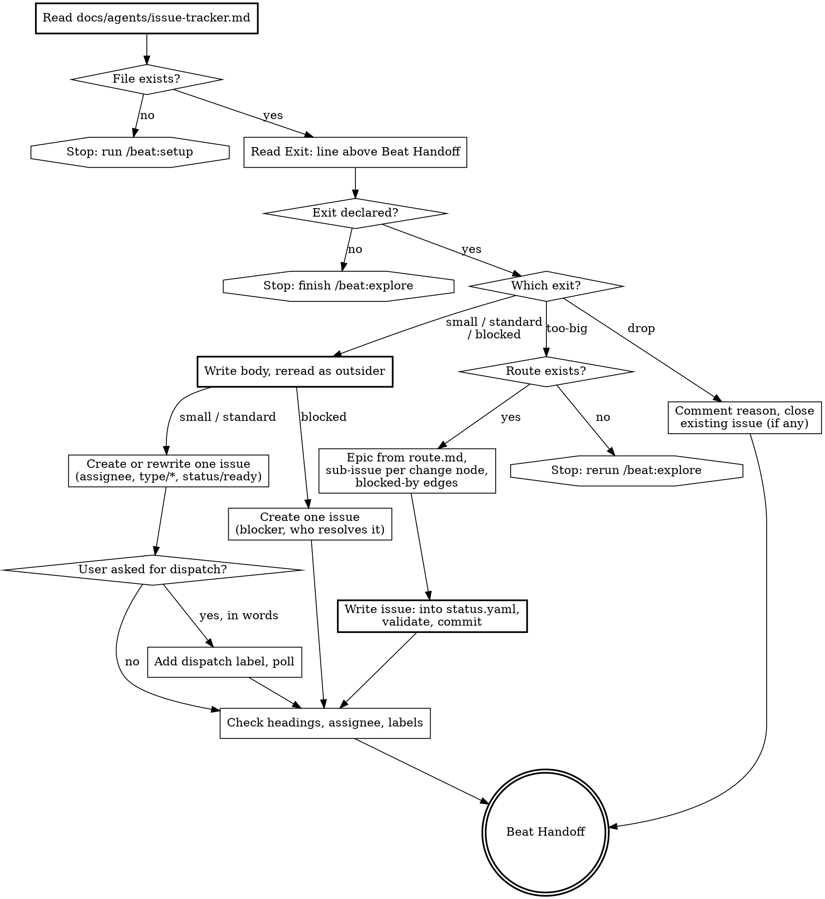

Turn the conclusion of a `/beat:explore` session into tracker issues. The issue body is the specification: whoever picks the issue up (an orchestrator running `/beat:design` unattended, or a person next week) never sees this conversation, so a decision that is not in the body was never made.

<decision_boundary>

**Use for:**
- Opening one issue for an exploration that ended `small` or `standard`
- Rewriting an existing issue (the one the exploration started from) into the specification format
- Opening an epic plus one sub-issue per change node for an exploration that ended `too-big`
- Recording a `blocked` exploration as an issue, or closing an issue the exploration decided to `drop`
- Adding the dispatch label when the user asks for it in words

**NOT for:**
- An idea that has not been explored yet, or someone else's issue nobody has read (use `/beat:explore`, which can start from `#<n>`)
- Creating spec artifacts (use `/beat:design`)
- Writing a PR body (follow the project's PR template)

**Trigger examples:**
- "開成 issue" / "把結論開票" / "交給 Rhythm" / "open an issue for what we just decided" / "split this route into issues"
- Should NOT trigger: "let me think about X first" / "design this feature" / "write the PR description"

</decision_boundary>

<HARD-GATE>
Before anything else: read `docs/agents/issue-tracker.md` (its place in the project: `references/project-layout.md`). If it does not exist, stop with exactly:
`No docs/agents/issue-tracker.md. Run /beat:setup to create it.`
Never fall back to a default tracker, CLI, owner, assignee or label.

Never add the dispatch label unless the user asked for dispatch in words ("走 ticket flow", "打 `<dispatch-label>`（例如 rhythm-change）", "交給 Rhythm", "dispatch it"). Otherwise name it as the next step.
</HARD-GATE>

**Prerequisites** (check before proceeding)

| Input | When | Priority |
|-------|------|----------|
| `docs/agents/issue-tracker.md` | Always, first | MUST: absent → stop and name `/beat:setup` |
| The exploration's exit (from the `Exit:` line directly above its `## Beat Handoff` block) | Always | MUST: absent → stop, finish `/beat:explore` first |
| `beat/routes/<route>/` (`route.md` + `status.yaml`) | Exit `too-big` | MUST: absent → stop, rerun `/beat:explore` |
| `beat/config.yaml` `language` | Writing the body | OPTIONAL: picks the section titles |

`docs/agents/issue-tracker.md` follows one of `references/issue-tracker-github.md`, `references/issue-tracker-gitlab.md` or `references/issue-tracker-other.md`. Everything tracker-specific comes from it at run time:

| What | Where in `docs/agents/issue-tracker.md` |
|------|------------------------------------------|
| Tracker, CLI, create / read / list / label / comment / close / sub-issue / blocked-by commands | `## Conventions` |
| Assignee, dispatch label, the five `status/*` labels | `## Vocabulary` |
| How a route becomes an epic and sub-issues | `## Epics` |

When a recipe this skill needs is missing from Conventions (for example no command to edit an existing body), ask the user for it; do not guess one from another tracker.

## Rationalization Prevention

| Thought | Reality |
|---------|---------|
| "The user clearly wants this dispatched, I'll add the dispatch label" | Dispatch starts an unattended run under someone's account. Only words from the user add it ("交給 Rhythm", "打 `<dispatch-label>`（例如 rhythm-change）"). Otherwise list it as the next step. |
| "No issue-tracker.md, but it's obviously GitHub — I'll just use `gh`" | The owner, assignee and labels are project facts you do not have. Stop and name `/beat:setup`; it writes the file in one step. |
| "The exploration didn't declare an exit, but it's obviously small" | The exit decides how many issues, which labels, and whether a route is needed. Guessing it here re-sizes the work without the person who explored it. Send them back to `/beat:explore`. |
| "This decision follows from what we agreed, so it goes under 已定案" | The locked heading tells design never to reopen a line. An inferred decision locked there can never be questioned. Only what the user agreed to goes there; inferences go under 留給 design 決定. |
| "too-big, but I'll just open the issues; the route can come later" | The epic body is generated from `route.md` and each node gets its issue number written back. No route means no map and no link. Stop and rerun `/beat:explore`. |
| "The body reads fine to me" | You saw the conversation. Reread it as someone who did not: every nickname, "the option above" and "that file" becomes a noun or a path. |

## Red Flags — STOP if you catch yourself:

- Typing a tracker command that is not in `docs/agents/issue-tracker.md`
- Adding the dispatch label, or clearing `status/blocked`, without the user's words
- Writing any status label outside the five in Vocabulary
- Putting a decision under the locked heading that the user never confirmed
- Creating issues for a `too-big` exit without `beat/routes/<route>/`
- Passing a multi-line body inline instead of through a body file

---

## Process Flow



---

## Steps

### 1. Read the tracker configuration

Read `docs/agents/issue-tracker.md`. Absent → print `No docs/agents/issue-tracker.md. Run /beat:setup to create it.` and end with the handoff block (`next: /beat:setup`, `blocked-on: no docs/agents/issue-tracker.md`).

Take from it: the tracker and its CLI, every command recipe under Conventions, the assignee, the dispatch label and the five status labels (`status/ready`, `status/running`, `status/waiting`, `status/blocked`, `status/in-review`) from Vocabulary, and the epic rules from Epics. Use the recipes as written, substituting only numbers, titles and file paths.

### 2. Read the exit

Read the exit and preset from the `Exit:` line directly above the exploration's `## Beat Handoff` block (`Exit: <small|standard|too-big|blocked|drop> (preset <...>)`). `small` always names a preset (`minimal` or `technical`); `standard` names one only when the exploration agreed on it, otherwise the line is plain `Exit: standard`.

No `Exit:` line → stop: "This exploration has no declared exit. Finish `/beat:explore` first; the exit decides how many issues to open and which labels they get." Do not infer one.

Also note whether the exploration started from an existing issue (`/beat:explore #<n>`, or a route node with an `issue:` field). That issue is rewritten, not duplicated.

Before creating anything new, search open issues once with the list recipe for an epic this work belongs to and for overlapping issues. An epic match becomes the `Epic: #<n>` first line; overlaps go under the not-now section or a closing related-issues line.

### 3. Write the body (`small`, `standard`, `blocked`)

`too-big` skips this step: its epic and sub-issue bodies come from `route.md`, and step 4.2 rereads them the same way.

Section titles follow `beat/config.yaml` `language`: a `zh-*` language uses the zh-TW titles below; any other value, and no config (Beat's default is English), uses the English titles. The two locked titles are copied exactly, because `/beat:design` finds them by title.

```
Route: <route>/<node-id>                     ← only when rewriting a route sub-issue; stays the first line
Epic: #<n>                                   ← only when step 2 found one
出口：<exit>（preset <minimal|technical|standard|full>）   ← preset part only when the exploration's Exit: line names one
```

When the issue being rewritten is a route sub-issue (created with `Route: <route>/<node-id>` as its first line), that line stays the first body line, then the optional `Epic:` line, then the exit line.

English: `Exit: <exit> (preset <...>)`. It carries the same exit and preset as the exploration's `Exit:` line, and no preset when that line has none (`出口：standard` / `Exit: standard`). The exit line comes after any `Route:` and `Epic:` lines and before every section; when it names a preset, `/beat:design` uses it and skips its preset question; when it does not, design asks.

| zh-TW | English | What goes in it |
|-------|---------|-----------------|
| `## 已定案（不要重新討論）` | `## Decided (do not reopen)` | **Locked.** Decisions the user agreed to in the exploration, each with the trade-off they accepted. Nothing inferred, nothing you proposed that the user did not confirm. |
| `## 先不做` | `## Not now` | **Locked.** What was discussed and excluded, with the reason. |
| `## 目標` | `## Goal` | What is true for users or the system when this is done; background and evidence (`file:line`, production data). |
| `## User stories` | `## User stories` | Numbered `As a <actor>, I want <feature>, so that <benefit>`, as many as the exploration supports and no more. |
| `## 測試 seam` | `## Test seam` | The highest layer the behaviour can be tested at, `@e2e` or `@behavior`, and why that layer. |
| `## 範圍` | `## Scope` | Files or modules that will change, tests, docs. |
| `## 驗收方式` | `## Acceptance` | Observable conditions (test assertion, stored field, log line, behaviour) that design can rewrite as scenarios. |
| `## 留給 design 決定` | `## Left to design` | Open points design may settle on its own without leaving the goal. Inferred decisions go here, not under the locked title. |

Leave out a section the exploration gave you nothing for, except the two locked ones (write `- 無` / `- None` when empty). Something that changes direction and is still undecided belongs in no section: go back to `/beat:explore`, or make the exit `blocked`.

For `blocked`, the body states what blocks the work, what kind of block it is (research, prototype, decision), who can resolve it, and the question as the exploration phrased it. The section table applies where it has content.

Then reread the body as a reader who did not see the conversation. Every conversational shorthand (option labels, nicknames, "the approach above", "that file") becomes a noun, a path or a behaviour.

### 4. Create or rewrite

Title: conventional-commit form, `type(scope): one line`. Write the body to a temporary file outside the repository (for example from `mktemp`) and send it with the tracker's body-file recipe; never pass a multi-line body inline.

**`small` / `standard`** — one issue. Assignee from Vocabulary. One `type/*` label (ask the user which when it is not obvious from the title) plus `status/ready`. Existing issue from step 2: rewrite its body (and title if needed) and add the assignee and labels; otherwise create it.

**`blocked`** — one issue as written in step 3. No status label, no dispatch label, no assignee: nothing can run until the block is resolved.

**`drop`** — create nothing. If the exploration started from an issue, comment the one-line reason and close it with the close recipe. No issue → just report.

**`too-big`** — the route must exist: `beat/routes/<route>/route.md` and `status.yaml` (schema: `references/route-schema.md`). Absent → stop: "Exploration ended too-big but no route exists; rerun /beat:explore". Otherwise:

1. Create the epic issue. Title from the route's `# Route:` line; body generated from `route.md`'s Destination, Decisions so far, Not yet specified and Out of scope sections, plus the exit line `出口：too-big` (or `Exit: too-big`).
2. For each `type: change` node, create one sub-issue: title from the node's `title` (in conventional-commit form), first body line `Route: <route>/<node-id>`, then what `route.md` says about it. No status label and no assignee — each node is explored on its own, and its own `/beat:to-issue` run later rewrites this issue. Reread the epic and every sub-issue body as in step 3 (no conversational shorthand) before sending it.
3. Link every sub-issue to the epic with the sub-issue recipe. For every `blocked_by` entry between change nodes, add a blocked-by edge with the blocked-by recipe (fallback lines as that recipe says). A blocker that is a research, prototype or decision node has no issue: name it in the sub-issue body (`Blocked by route node <route>/<node-id> (<type>)`).
4. Read `beat/routes/<route>/status.yaml`, add `issue: "#<n>"` (or the tracker's key, e.g. `"PROJ-123"`) to each node that got an issue, keep every other field and node unchanged, and write it back.
5. Run `node <skill-dir>/scripts/validate-beat.mjs --file beat/routes/<route>/status.yaml`. Fix what it lists before going on.
6. Commit only the route file: `route(<route>): link nodes to issues`.

### 5. Dispatch label (only on request)

Add the dispatch label only to a `small` / `standard` issue that has `status/ready`, and only when the user asked for dispatch in words. Otherwise list "add `<dispatch-label>`" as the next step in the report and stop here.

When added, poll with the read recipe for up to one minute (roughly every ten seconds) until `status/running` (dispatched) or `status/blocked` (refused) appears. Neither after a minute → report "the orchestrator has not responded yet".

On `status/blocked`: read the orchestrator's comment, tell the user what it says and propose the fix to the issue. Clear `status/blocked` only after the user agrees — clearing it re-dispatches.

### 6. Check

Read each issue back with the read recipe and print its `## ` headings, assignee and labels. Confirm:

- every decision the user agreed to in the exploration is under the locked heading, and nothing there is inferred;
- the assignee and labels match the exit (step 4) and the status label is one of the five;
- for `too-big`, every change node in `status.yaml` carries its `issue`.

Report the issue links, the exit, the labels added, and what is still pending (dispatch label not added, orchestrator not yet responded).

### 7. Beat Handoff

End with the block from `references/handoff-report.md`. There is no change:

```
## Beat Handoff
change: none              phase: to-issue
commit: <short sha>       branch: <branch>                  dirty: <yes|no>
next: <command>
blocked-on: none | <why the issue could not be created>
```

`commit`, `branch`, `dirty` come from git, run now. `next`:

| Exit | `next` |
|------|--------|
| `small` / `standard` | `/beat:design <change-name>` (whoever picks up the issue; after dispatch, the orchestrator runs it) |
| `too-big` | `/beat:explore <route>` — pick the first frontier node |
| `blocked` / `drop` | `none` |

When the run stopped (no tracker file, no exit, no route), `blocked-on` says which, and `next` is the command that resolves it (`/beat:setup` or `/beat:explore`).

---

## Guardrails

- **Do read the tracker file first** — every command, account and label comes from `docs/agents/issue-tracker.md`
- **Don't dispatch unasked** — the dispatch label needs the user's words; so does clearing `status/blocked`
- **Don't guess the exit** — no declared exit, no issue
- **Don't lock inferences** — the locked heading holds only what the user agreed to
- **Don't invent labels** — one `type/*`, and only the five status labels from Vocabulary
- **Do write the body for a stranger** — no conversational shorthand survives the reread
- **Do keep the route intact** — add `issue:` fields only, validate, commit the route file alone
