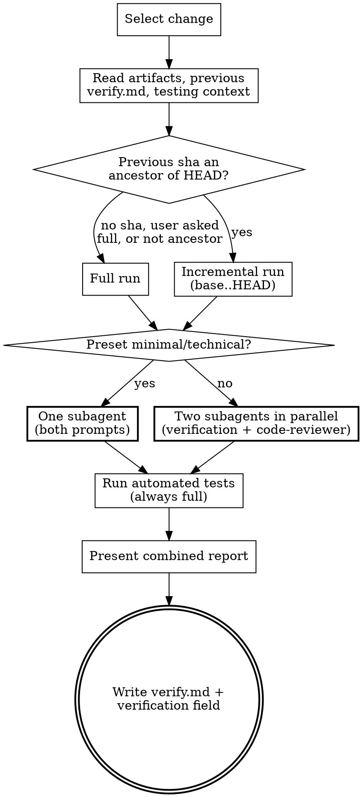

Verify implementation against change artifacts across five dimensions. Uses independent subagents to eliminate context bias. Writes findings to `verify.md` so `/beat:apply fix-from-verify` can act on them without a human relaying them.

<decision_boundary>

**Use for:**
- Validating implementation completeness against spec artifacts before archive
- Verifying distilled specs match current code behavior (accuracy mode, `source: distill`)
- Independent verification via subagents to catch context bias
- Re-verifying after fixes (incremental: only what changed since the last run)
- Surfacing living-doc drift (Layer 1/2/3) as advisory findings

**NOT for:**
- Creating or modifying spec artifacts (use `/beat:design`)
- Writing tasks (use `/beat:plan`)
- Running implementation or fixing findings (use `/beat:apply`)
- Archiving the change (use `/beat:archive`)

**Trigger examples:**
- "Verify the change" / "Check implementation against spec" / "Run verification" / "Re-verify after the fixes"
- Should NOT trigger: "design a feature" / "implement the change" / "archive it"

</decision_boundary>

<HARD-GATE>
You MUST dispatch independent subagents for verification — NEVER verify implementation yourself
in the main session. The main session has context bias from the conversation history.

How many subagents is decided by the change's `preset` in status.yaml, not by you:
- `full`, `standard`, `custom`, or absent: dispatch the verification subagent AND the code-reviewer
  in parallel — they are independent checks.
- `minimal` or `technical`: dispatch ONE subagent carrying both prompts, in a fresh context.
  One is the floor; it is never zero, and it is never the main session.

If a subagent fails, proceed with findings from the other. If BOTH fail (or the single one
fails), report the failure — do NOT fall back to self-verification.

If the user explicitly asks you to skip the subagents, say that a main-session check carries
context bias and is not a verification, confirm once, and if they insist do the quick check they
asked for — but write nothing to `verification` or `verify.md`. Only a subagent run is an outcome.

After presenting the combined report: you MUST write `verify.md` and record the outcome in the
top-level `verification` field of status.yaml (see step 6). If verification could not run at all,
do NOT record — a failed run is not a verification outcome.
</HARD-GATE>

## Rationalization Prevention

| Thought | Reality |
|---------|---------|
| "The change is small, I can verify it myself" | Self-verification creates confirmation bias. You saw the implementation — you can't objectively verify it. Small changes get one subagent, not none. |
| "I already reviewed the code during apply" | That's exactly why you need an independent verifier. Familiarity breeds blind spots. |
| "Running two subagents is overkill for this" | The preset already made that call. `minimal` runs one; everything else runs two. Don't re-decide it per run. |
| "I'll just run the tests, that's verification enough" | Tests verify behavior but not spec alignment, design adherence, or code quality. |
| "The user told me not to dispatch agents, so a quick look counts as verify" | It counts as a quick look. Say so, confirm once, do it — and leave `verification` unset, so archive still warns that this change was never verified. |
| "I'll dispatch them sequentially to save context" | They're independent — parallel dispatch is faster and prevents one report from biasing the other. |
| "The report is delivered, the status.yaml write is just bookkeeping" | `verify.md` is what `/beat:apply fix-from-verify` reads; the `verification` field is how archive knows verify ran. Skip either and the loop breaks. |
| "Only two files changed since last time, I'll just eyeball the diff" | That is what incremental mode is for — a subagent reads the diff, not you. |
| "There are still WARNINGs open, we should go another round" | Zero open CRITICAL is converged. WARNINGs and SUGGESTIONs are surfaced for the user to pick from, not a reason to loop. Every extra round finds new edge cases in the code the last fix touched; that is the loop, not progress. |
| "This touched a shared file, I'd better run full again" | A full run after round 1 is the user's call, not the skill's. Say which files were shared and let them decide. |

## Red Flags — STOP if you catch yourself:

- Verifying any dimension yourself instead of dispatching a subagent
- Dispatching subagents sequentially instead of in parallel (standard strength)
- Dropping the code-quality prompt on a `minimal` change instead of folding it into the single subagent
- Claiming verification passed without reading the subagent reports
- Editing code or artifacts during verification (the ONLY writes are `verify.md` and the `verification` field in status.yaml)
- Presenting the report without writing `verify.md` and the `verification` field
- Falling back to self-verification because a subagent failed
- Running incremental mode when `verification.sha` is not an ancestor of HEAD
- Recording a new SUGGESTION on round 2 or later, or a new WARNING on round 3 or later (see Convergence)
- Recommending another fix round when zero CRITICAL findings are open

## Process Flow



**Input**: Optionally specify a change name. If omitted, infer from context or prompt. `full` forces a full run.

**Steps**

1. **Select the change**

   If no name provided:
   - Look for `beat/changes/` directories (excluding `archive/`)
   - If only one exists, use it
   - If multiple exist, use **AskUserQuestion tool** to let user select

2. **Read all artifacts and determine testing context**

   Read from `beat/changes/<name>/`:
   - `status.yaml` (schema: `references/status-schema.md`) — note `preset` and any existing `verification`
   - `features/*.feature` (all Gherkin files, if gherkin status is `done`)
   - `proposal.md` (if exists)
   - `design.md` (if exists)
   - `tasks.md` (if exists)
   - `verify.md` (if exists, format: `references/verify-findings.md`) — the previous run's findings

   Read `beat/config.yaml` (if exists, schema: `references/config-schema.md`).

   **Determine drive mode:**
   - If `gherkin` status is `done` → **Gherkin-driven verification**
   - If `gherkin` status is `skipped` → **Proposal-driven verification**

   **Determine run mode and round:**
   - **full** when: no previous `verification`, the user asked for `full`, the previous run has no `sha`, or `git merge-base --is-ancestor <sha> HEAD` fails (rebased or amended since).
   - **incremental** otherwise: `base` = previous `sha`; collect `git diff --stat <base>..HEAD` and the list of scenarios, proposal goals and design decisions those files relate to. Say which mode is running and why.
   - **round** = previous `verification.round` + 1 (1 when there is no previous run). The round governs what new findings may be recorded — see Convergence below.

   **Determine testing context** (three-layer priority: tag > source > config):
   - **Config layer**: Is `testing.required` set to `false`? If yes, skip test existence checks globally.
   - **Source layer**: Does `status.yaml` contain `source: distill`? If yes, Dimension 1 switches to **accuracy mode** (see below).
   - **Tag layer**: Every scenario in a .feature file is expected to have a corresponding test (in TDD mode).
   - **Modified files**: Does `status.yaml` have `gherkin.modified`? If yes, collect the listed paths and their `.feature.orig` backup paths — the verification subagent needs them for semantic verification (Dimension 1B+).

2b. **Run the lint tools first**

   Run `node <skill-dir>/scripts/validate-beat.mjs --change <name>` and `node <skill-dir>/scripts/lint-features.mjs --require-covered-by beat/changes/<name>/features/*.feature` (see `references/lint-tools.md`); add a whole-project `lint-features.mjs` run when the change modified existing features. Keep both outputs; they go to the subagents as pre-computed findings so the subagents do not re-derive what a script already settled (annotation targets, layer tags, user story, schema). A lint error is a finding at WARNING, or CRITICAL when it is a missing test file.

3. **Dispatch the subagent(s)**

   **Agent A — Verification subagent** (subagent_type: `Explore`):
   Read `verification-subagent-prompt.md` for the complete subagent prompt.

   Provide ONLY:
   - All artifact contents (features, proposal, design, tasks)
   - Testing context (drive mode, testing config, source flag, tag counts)
   - Modified files list from `gherkin.modified` with their `.feature.orig` backup paths (if any)
   - Run mode; for incremental: `base`, the diff stat, the related scenarios/goals/decisions, and the previous findings still `open`
   - The lint output from step 2b
   - Do NOT pass conversation history or session context.

   **Agent B — Code quality review** (subagent_type: `general-purpose`):
   Read `code-reviewer-prompt.md` for the complete subagent prompt.

   Provide:
   - The change name and description (from proposal or status.yaml)
   - List of files created/modified during apply (incremental: since `base`)
   - The planning document (tasks.md or proposal.md) as the "original plan"
   - The git range (base..head SHAs) so the reviewer can read the diff

   This reviews: code quality, architecture, naming, error handling, test quality, security, and plan alignment. Its output is Dimension 4, classified in Beat's CRITICAL/WARNING/SUGGESTION vocabulary.

   **Standard strength** (`preset` full/standard/custom/absent): launch A and B simultaneously in a single message with two Agent tool calls.

   **Minimal strength** (`preset` minimal/technical): launch ONE agent (subagent_type: `general-purpose`) whose prompt is both files concatenated, with the inputs of both. It reports dimensions 1-5 in one report. Still a fresh context, still no conversation history.

   **Fallback**: If one agent fails, proceed with the other's findings. If all fail, report failure — do NOT self-verify.

4. **Run automated tests if available**

   Always full, even on incremental runs — this is the cheap whole-change check that catches "fixed A, broke B":
   - **Behavior tests**: run using `testing.behavior` framework (or auto-detect)
   - **E2E tests**: run using `testing.e2e` framework (or auto-detect). If `beat/changes/<name>/features/` contains feature files, combine BDD feature paths: `beat/features/` + `beat/changes/<name>/features/`
   - Report behavior and e2e results separately

5. **Present combined verification report**

   Combine the subagent reports:
   - Dimensions 1-3 from verification subagent (spec alignment)
   - Dimension 4 from code-reviewer (code quality)
   - Dimension 5 from verification subagent (living docs sync — Layer 1/2/3, advisory only)
   - Step 4 test results (if available)

   On an incremental run, prefix the report with what was and was not re-read.

   **Apply the convergence rules before writing anything** (see "Convergence" below): cap prose findings, drop new findings the round does not admit, detect divergence, and decide the verdict line.

6. **Write `verify.md` and record the outcome in status.yaml**

   Write `beat/changes/<name>/verify.md` per `references/verify-findings.md` (front matter fields, one line per finding, how ids carry across incremental runs), with the combined report as the body. Every finding from every subagent and every failing automated test becomes one `findings` line.

   Then read `status.yaml` (read before write — preserve existing fields) and set, per `references/status-schema.md`:

   ```yaml
   verification: { status: passed, critical: 0, warning: 2, date: YYYY-MM-DD, sha: <short sha>, mode: full }
   ```

   - `status: passed` when zero CRITICAL findings with `status: open`; `issues-found` otherwise
   - `critical` / `warning`: counts of open findings at those severities, including failing automated tests from step 4
   - Do NOT advance `phase` — verification outcome lives only in this field
   - Skip both writes entirely if verification could not run — report the failure instead

   Run `node <skill-dir>/scripts/validate-beat.mjs --file beat/changes/<name>/verify.md` and the same for `status.yaml` (see `references/lint-tools.md`); fix any schema error before presenting.

   Then end with the handoff block from `references/handoff-report.md`: `findings` from the counts above; `next` is `/beat:apply <name> fix-from-verify` when a CRITICAL is open, otherwise `/beat:archive <name>` — with the open WARNING / SUGGESTION ids listed in `blocked-on: none (open: F3, F7)` so the user can pick which to fix first.

## Convergence

Verification is a loop with `/beat:apply fix-from-verify`, and loops that re-open every severity on every round do not end: each fix touches code the next round reads fresh, and a careful reviewer always finds another edge case. These rules (adapted from cadence `self-review` / `pr-review`) decide when the loop is done. They are applied by the dispatcher after merging the subagent reports, never by the subagents.

| Rule | What it does |
|------|--------------|
| **Severity floor** | The change is **converged** when zero CRITICAL findings are open. Open WARNINGs and SUGGESTIONs are surfaced in the report and the handoff block; they are the user's to pick from, not a reason for another round. `next` is archive. |
| **Prose ceiling** | A finding whose `file` is prose (`.feature`, `.md`, docs) is capped at SUGGESTION whatever the subagent said, unless it is a missing test for a scenario (that stays CRITICAL) or a scenario that contradicts the code in accuracy mode. Wording, symmetry with a sibling scenario, drifted line numbers, counts, annotation placement — all SUGGESTION. |
| **Iteration ramp** | Round 1 records everything. Round 2 records new CRITICAL and new WARNING; new SUGGESTIONs are counted on one line (`+N suggestions not recorded`) and not written to verify.md. Round 3 and later record only new CRITICAL; everything else is counted. Re-checks of previously open findings are always recorded (still open / fixed). |
| **Round cap** | After round 3, do not recommend another fix round even for a CRITICAL. Report it, mark the change `issues-found`, and say that a change still producing CRITICALs on round 4 is too large — split it or fix by hand with the user. |
| **Divergence** | If this round's open count is larger than the previous round's, or at least three new findings sit in files the last fix-from-verify commit touched and none of the previous findings recur, say so in the report: the fixes are opening surfaces, not closing them. Recommend stopping and reviewing the last fix commit by hand rather than another round. |
| **Shared files** | A full re-run after round 1 is the user's decision. When the diff touched files many scenarios share, name them in the report and offer `/beat:verify <name> full`; do not require it, and archive does not require it. |

`verify.md` front matter records `round`; `status.yaml` `verification.round` carries it so the next run knows where it is.

**Issue Classification**
- CRITICAL: Must fix (missing scenario test [in coverage mode], inaccurate scenario [in accuracy mode], unimplemented goal, design violation, security vulnerability, failing automated test from step 4)
- WARNING: Should fix (partial coverage, possible divergence, non-executable test, Gherkin quality issues, code quality concerns, living-doc drift — Layer 1/2/3 sync gaps)
- SUGGESTION: Nice to fix (pattern inconsistency, minor improvement, missing test in distill mode, module without README)

**Dimension 5 is advisory** — its findings classify as WARNING or SUGGESTION only, never CRITICAL. The user decides whether to act before archiving; living-doc drift never blocks the archive.

**Graceful Degradation**
- Gherkin skipped: skip Dimension 1, strengthen Dimension 2 (proposal alignment)
- Only features exist: verify Gherkin coverage only
- Features + proposal: verify coverage + alignment
- Features + proposal + design: verify all five dimensions (Dimension 5 only when living docs exist)
- Always note which checks were skipped and why
